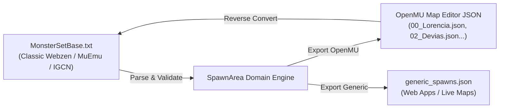

# MU Online Spawn & Spot Converter

[](https://github.com/hellonullen/muonline-spawn-converter/actions/workflows/build-test.yml)
[](https://dotnet.microsoft.com/)
[](https://opensource.org/licenses/MIT)
[](https://github.com/MUnique/OpenMU)
[](https://github.com/hellonullen/muonline-spawn-converter)

A modern, high-performance C# CLI tool and class library designed to parse classic MU Online `MonsterSetBase.txt` files and seamlessly convert them into **OpenMU Map Editor JSON**, universal JSON, or back into formatted `MonsterSetBase.txt`.

---

## 💡 The Problem & Motivation

For two decades, MU Online server administrators and developers (Webzen, MuEmu, IGCN, SCF, Louis) have configured monster spawns, guards, and grinding spots in text-based `MonsterSetBase.txt` files.

Next-generation emulators like [OpenMU](https://github.com/MUnique/OpenMU) utilize modern object-relational persistence (PostgreSQL) and a rich Web Blazor Map Editor that only accepts serialized JSON (`MapSpawnExport`). Until now, migrating thousands of custom spawns and spots from classic files to OpenMU required tedious manual entry or brittle ad-hoc scripts.

**`muonline-spawn-converter` bridges this gap.**



---

## ✨ Features

- ⚡ **High Performance & Zero Heavy Dependencies:** Built on pure .NET 9 with C# 13 language features.
- 🎯 **100% OpenMU Map Editor Compatible:** Produces exact `MapSpawnExport` DTOs (`FormatVersion: "1.0"`) ready for one-click import in OpenMU's Web Map Editor.
- 🧭 **Precise Direction Alignment:** Automatically resolves the Webzen-to-OpenMU direction discrepancy (Webzen `0 = West` mapped accurately to OpenMU `Direction.West = 1`).
- 📁 **Automated Per-Map Splitting:** Splits monolithic `MonsterSetBase.txt` files into individual map files (`00_Lorencia.json`, `01_Dungeon.json`, `02_Devias.json`, etc.) matching OpenMU's editor workflow.
- 🔄 **Bi-Directional Conversion:** Converts OpenMU Map Editor JSON back into clean, organized `MonsterSetBase.txt` files.
- 🛡️ **Zero Silent Data Loss:** Rigorous diagnostics for out-of-bound coordinates ($0 \le X, Y \le 255$), inverted boundaries ($X1 > X2$), and unregistered custom monsters or maps.
- 📦 **Dual Interface:** Use as a standalone CLI tool or embed `MuOnline.SpawnConverter.Core` as a reusable library in your own tools.

---

## 📊 Data Mapping Specification

| Classic MonsterSetBase | OpenMU JSON Property | Mapping & Conversion Rule |
| :--- | :--- | :--- |
| **Monster ID** | `MonsterNumber` | **1:1 Direct match** with OpenMU's 500+ standard monster definitions. |
| **Map ID** | Per-Map Filename | **1:1 Direct match** with Webzen map indices ($0 = \text{Lorencia}$, $2 = \text{Devias}$, etc.). |
| **X, Y (Section 0)** | `X1, Y1, X2, Y2` | Point coordinates ($X1 = X2 = X$, $Y1 = Y2 = Y$). |
| **X1..Y2 (Section 1)** | `X1, Y1, X2, Y2` | Area bounding box. Inverted ranges ($X1 > X2$) are automatically sanitized with a warning. |
| **Quantity (Section 1/2)** | `Quantity` | Spawn count within area or hotspot cluster. |
| **Direction** | `Direction` | **Offset Mapping:** OpenMU reserves `0 = Undefined`, shifting Webzen directions by $+1$ ($0 \rightarrow \text{West}$, $2 \rightarrow \text{South}$, etc.). |
| **SpawnTrigger** | `SpawnTrigger` | Default `0` (`Automatic`). |
| **WaveNumber** | `WaveNumber` | Default `0`. |

---

## 🚀 Quick Start

### Prerequisites
- [.NET 9.0 SDK](https://dotnet.microsoft.com/download/dotnet/9.0) (or runtime)

### Build from Source
```bash
git clone https://github.com/hellonullen/muonline-spawn-converter.git
cd muonline-spawn-converter
dotnet build
```

---

## 💻 CLI Usage

```text
USAGE:
  mu-spawn-converter convert <input_file> [options]
  mu-spawn-converter reverse <input_json> [options]
  mu-spawn-converter info <input_file>
```

### 1. Convert MonsterSetBase to OpenMU Map Editor JSON (Split by Map)
```bash
dotnet run --project src/MuOnline.SpawnConverter.Cli -- convert MonsterSetBase.txt -o ./openmu_spawns/
```
*Generates separate JSON files for each map inside `./openmu_spawns/`:*
- `00_Lorencia.json`
- `01_Dungeon.json`
- `02_Devias.json`
- `03_Noria.json`
- `08_Tarkan.json`

### 2. Convert to All Formats (OpenMU + Universal Generic JSON)
```bash
dotnet run --project src/MuOnline.SpawnConverter.Cli -- convert MonsterSetBase.txt -o ./dist/ -f all
```

### 3. Convert OpenMU JSON back to MonsterSetBase.txt (Reverse)
```bash
dotnet run --project src/MuOnline.SpawnConverter.Cli -- reverse 00_Lorencia.json -o MonsterSetBase_Lorencia.txt
```

### 4. Analyze & Inspect File Statistics
```bash
dotnet run --project src/MuOnline.SpawnConverter.Cli -- info MonsterSetBase.txt
```
*Output preview:*
```text
File Analyzed  : MonsterSetBase_Full_sample.txt
Total Lines    : 65
Valid Spawns   : 34
Warnings       : 0
Errors         : 0
Unique Maps    : 6

Map Breakdown:
  - [ 0] Lorencia                 :     9 spawns
  - [ 1] Dungeon                  :     3 spawns
  - [ 2] Devias                   :     7 spawns
  - [ 3] Noria                    :     7 spawns
  - [ 4] Lost Tower               :     4 spawns
  - [ 8] Tarkan                   :     4 spawns
```

---

## 📚 Library Usage (C# API)

You can reference `MuOnline.SpawnConverter.Core` in your own C# projects:

```csharp
using MuOnline.SpawnConverter.Core.Parsers;
using MuOnline.SpawnConverter.Core.Exporters;

// 1. Parse classic MonsterSetBase.txt
var parser = new MonsterSetBaseParser();
var result = parser.ParseFile("MonsterSetBase.txt");

// Check diagnostic issues
foreach (var issue in result.Issues)
{
    Console.WriteLine($"[{issue.Severity}] Line {issue.LineNumber}: {issue.Message}");
}

// 2. Export to OpenMU Map Editor JSON
var openMuExporter = new OpenMuMapEditorExporter();
string lorenciaJson = openMuExporter.Export(result.GetSpawnsForMap(0));

// Or split all maps automatically into a directory
openMuExporter.ExportSplitMaps(result, "./output_openmu/");

// 3. Export to Generic JSON
var genericExporter = new GenericJsonExporter();
string genericJson = genericExporter.Export(result.Spawns);
```

---

## 🧪 Testing

The solution includes an extensive xUnit test suite verifying parsers, boundary checks, enum converters, and round-trip fidelity:

```bash
dotnet test
```

---

## 📂 Repository Structure

```text
muonline-spawn-converter/
├── .github/
│   └── workflows/
│       └── build-test.yml          # Automated GitHub Actions CI workflow
├── src/
│   ├── MuOnline.SpawnConverter.Core/
│   │   ├── Data/                  # Standard Map & Monster registries
│   │   ├── Exporters/             # OpenMU, Generic JSON, & MSB Exporters
│   │   ├── Models/                # Domain models, Enums, and DTOs
│   │   └── Parsers/               # MonsterSetBase parser engine
│   └── MuOnline.SpawnConverter.Cli/
│       └── Program.cs             # CLI entrypoint with formatted color output
├── tests/
│   └── MuOnline.SpawnConverter.Tests/ # xUnit test suite
├── samples/                       # Realistic sample MonsterSetBase files
├── LICENSE                        # MIT License
└── README.md                      # Documentation
```

---

## 📄 License

This project is licensed under the **MIT License** - see the [LICENSE](LICENSE) file for details.

Developed with ❤️ for the MU Online & OpenMU modding community.
